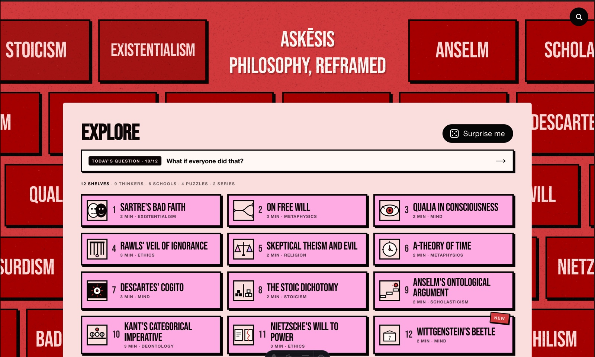
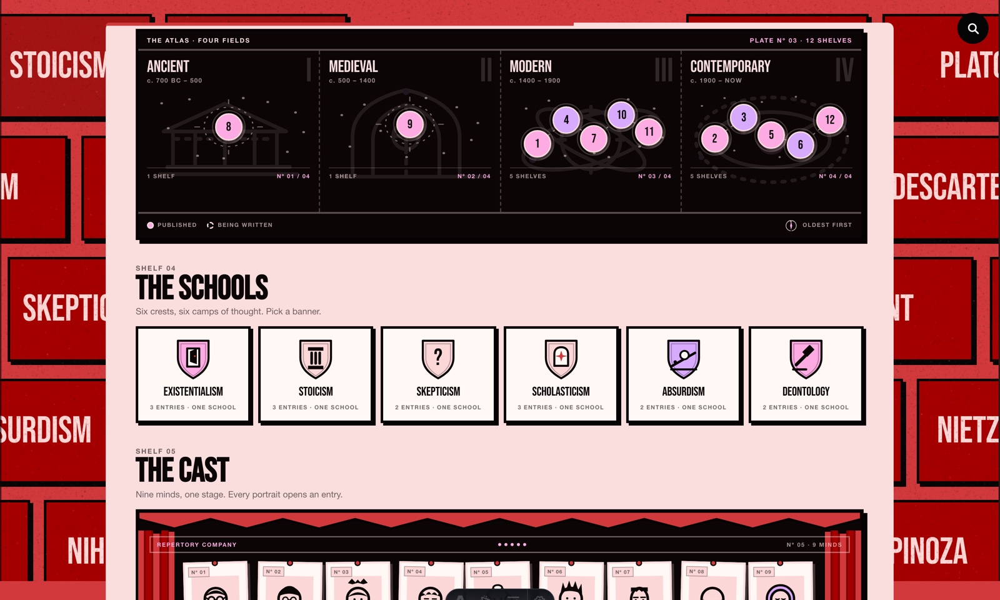
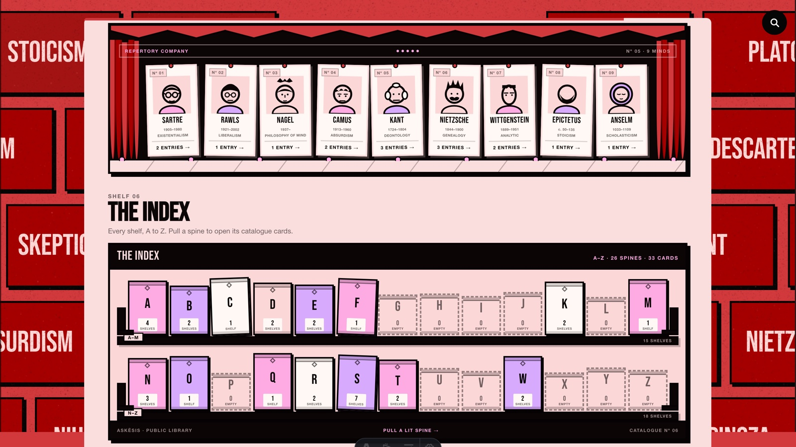
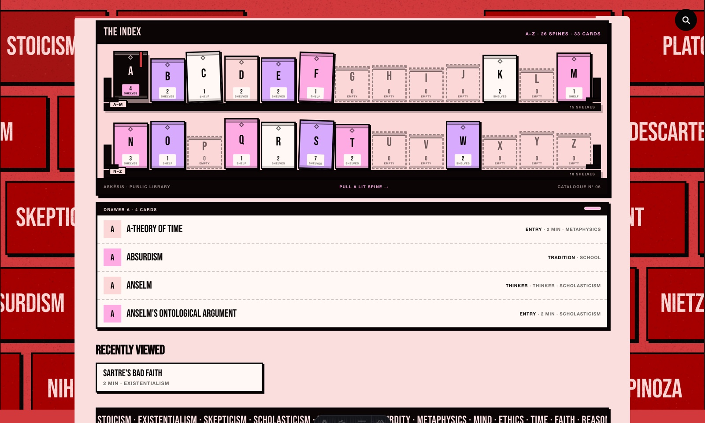
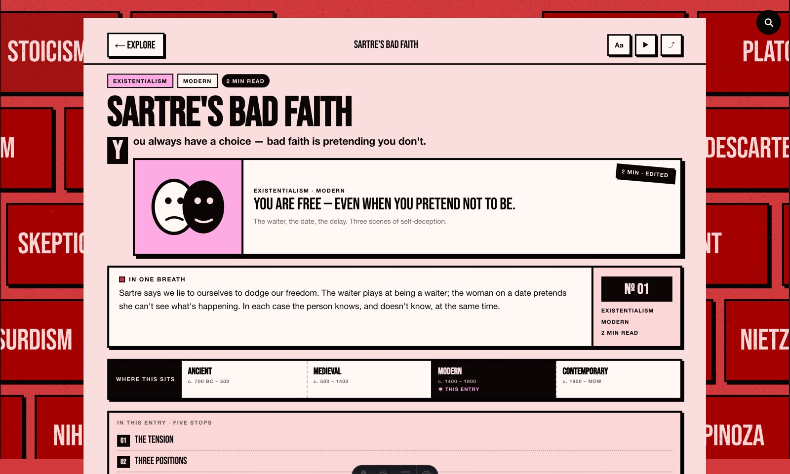
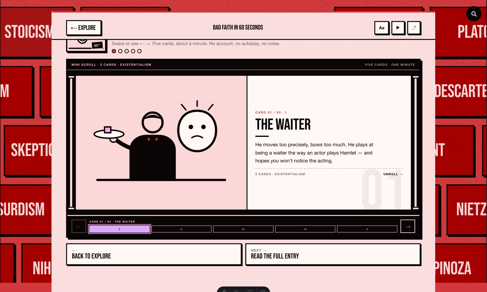
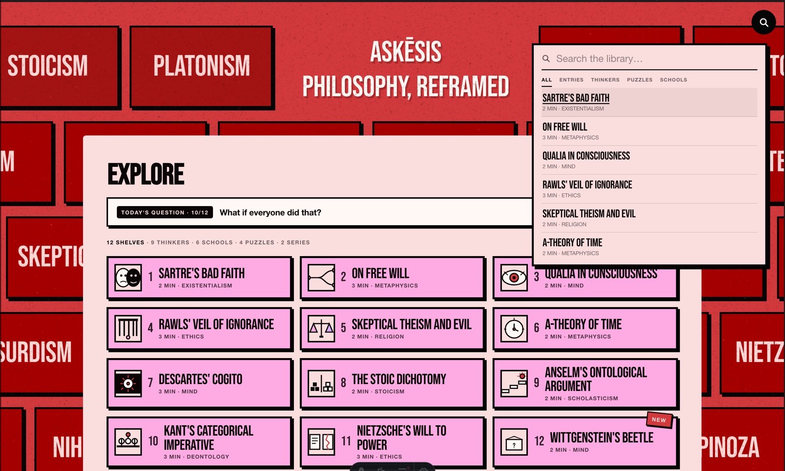
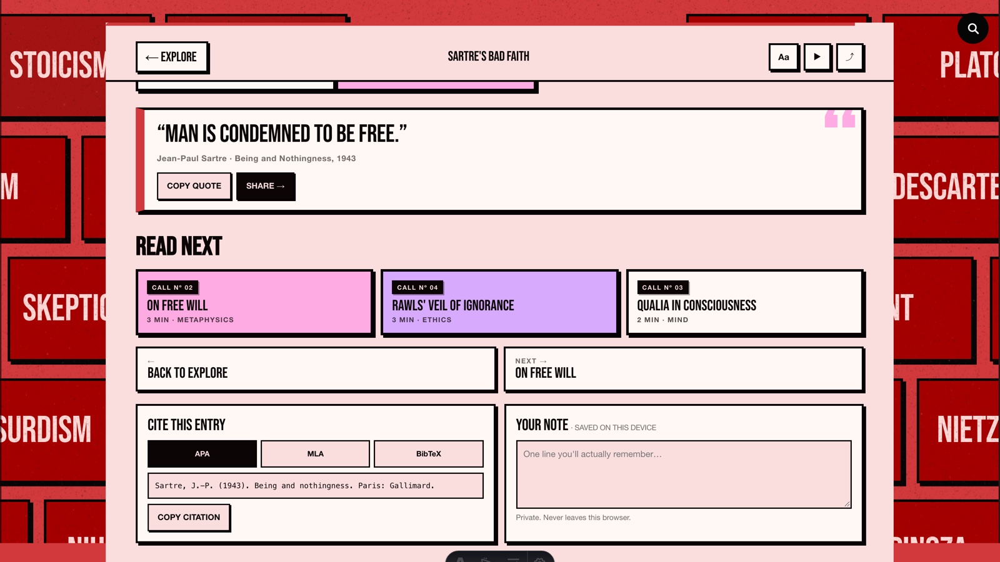
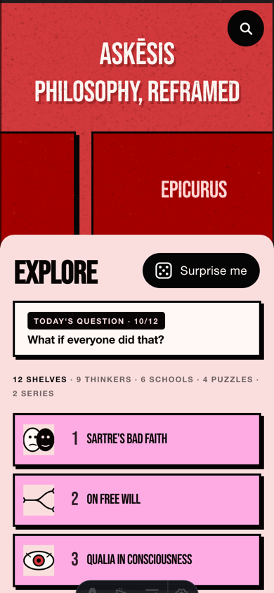

<div align="center">

# ASKĒSIS

### PHILOSOPHY, REFRAMED

A pocket library of philosophy. Twelve two-minute shelves, nine thinkers,
six schools, four thought experiments — set as one red poster and a single
cream reading sheet.

[](https://astro.build)
[](https://abhinav-prabhakar.github.io/Askesis/)
[](https://abhinav-prabhakar.github.io/Askesis/)
[](https://abhinav-prabhakar.github.io/Askesis/)

<br>

<a href="https://abhinav-prabhakar.github.io/Askesis/">
  
</a>

**[Enter the library →](https://abhinav-prabhakar.github.io/Askesis/)**

*No account · no ads · no autoplay · no analytics*

</div>

---

## A LIBRARY, NOT A FEED

No chronology, no infinite scroll, no up-next. Just six rooms you can walk
through in an afternoon. Even the red cards behind the sheet are doors.

<a href="https://abhinav-prabhakar.github.io/Askesis/">
  
</a>

<p align="center"><b>THE ATLAS</b> — every shelf plotted on a star chart, from Thales to the block universe.</p>

<table>
<tr>
<td width="50%">
<a href="https://abhinav-prabhakar.github.io/Askesis/"></a>
</td>
<td width="50%">
<a href="https://abhinav-prabhakar.github.io/Askesis/"></a>
</td>
</tr>
<tr>
<td valign="top"><b>THE CAST</b><br>Nine thinkers pinned to a working proscenium — drapes, marquee, footlights. Pull a playbill.</td>
<td valign="top"><b>THE INDEX</b><br>A–Z as a physical bookcase. Pull a lit spine; the drawer opens to its cards.</td>
</tr>
</table>

## TWO MINUTES IN, ONE IDEA OUT

Every shelf is edited to the same shape: a hook, one breath, three positions,
the argument in three lines, the strongest objection, a quote, and what to read next.

<a href="https://abhinav-prabhakar.github.io/Askesis/entry/sartre-bad-faith/">
  
</a>

<table>
<tr>
<td width="50%">
<a href="https://abhinav-prabhakar.github.io/Askesis/series/bad-faith-60/"></a>
</td>
<td width="50%">
<a href="https://abhinav-prabhakar.github.io/Askesis/"></a>
</td>
</tr>
<tr>
<td valign="top"><b>MINI SCROLLS</b><br>Five cards, sixty seconds. Swipe or use the rail — the whole argument on one spool.</td>
<td valign="top"><b>THE CATALOGUE</b><br>Search entries, thinkers, schools, puzzles. Press <kbd>/</kbd> anywhere.</td>
</tr>
</table>

## READ IT, THEN KEEP IT

Copy a citation in APA, MLA, or BibTeX. Save a private note. The quote card is built
to be shared as an image, not to chase a click.



## SMALL SCREEN, SAME LIBRARY



The poster folds down to a masthead, and the sheet takes the whole screen.

- One column, no horizontal scroll.
- Search, filters, and the cast reflow — nothing hides behind a menu.
- The stage and the bookcase keep their proportions instead of shrinking to noise.
- Works offline once loaded; the whole library is static HTML.

<br clear="both">

---

## UNDER THE HOOD

| | |
|---|---|
| **Framework** | Astro 5 — static output, no hydration |
| **Runtime** | ~30 KB of hand-written vanilla JS for search, notes, and the sheet |
| **Art** | Every portrait, crest, chart, and diagram is inline SVG written by hand |
| **Type** | Bebas Neue + Helvetica, self-hosted |
| **Privacy** | No cookies, no analytics, no third-party requests |
| **Deploy** | Built output committed to `docs/`, served by GitHub Pages |

```sh
git clone https://github.com/Abhinav-Prabhakar/Askesis.git
cd Askesis
npm install
npm run dev       # http://localhost:4321/Askesis/
```

```sh
npm run build     # writes the static site to docs/
npm run deploy    # rebuild, commit docs/, push
```

> **Pages setup:** Settings → Pages → Deploy from a branch → `main` / `/docs`.
> No Actions, no build service. The committed site is the site.

Design rules, tokens, and every component live in [**`design.md`**](design.md).

<div align="center">
<br>

**“MAN IS CONDEMNED TO BE FREE.”**

*Twelve shelves. Nine minds. One reading sheet.*

**[Enter the library →](https://abhinav-prabhakar.github.io/Askesis/)**

</div>
